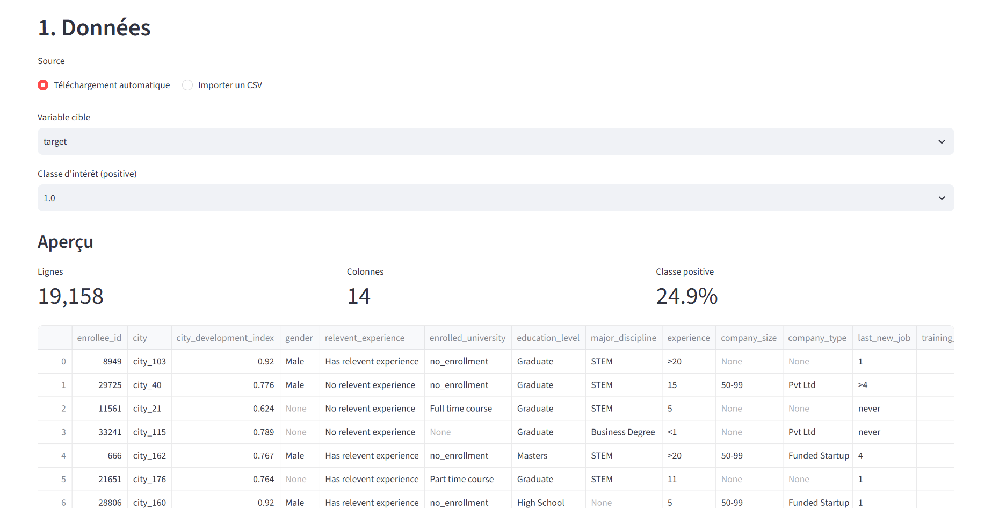
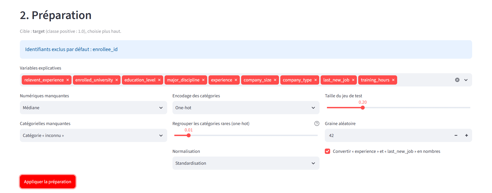
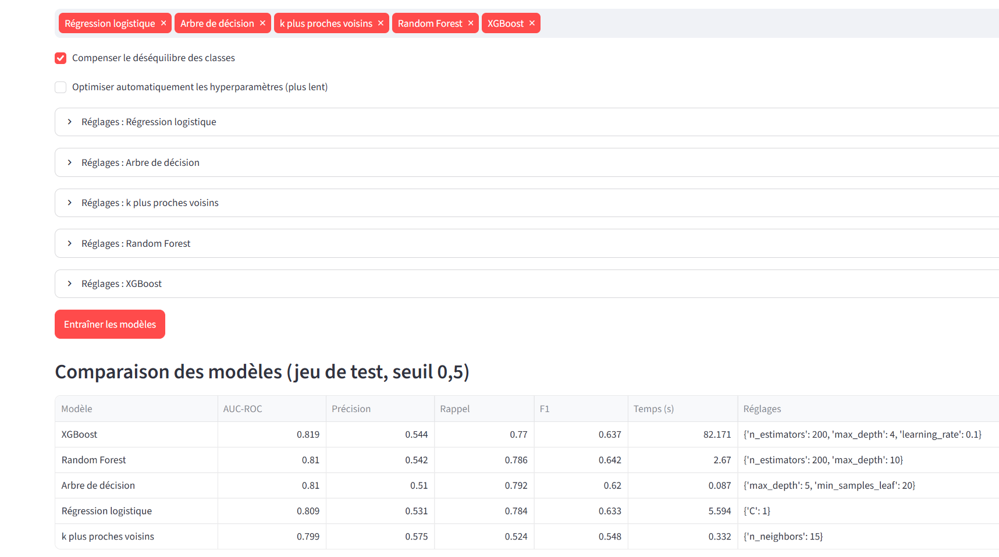
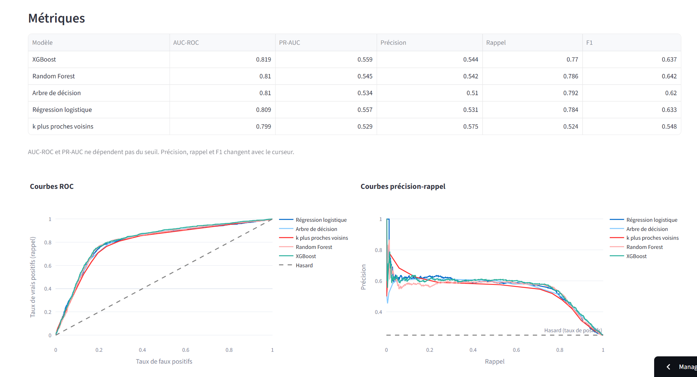
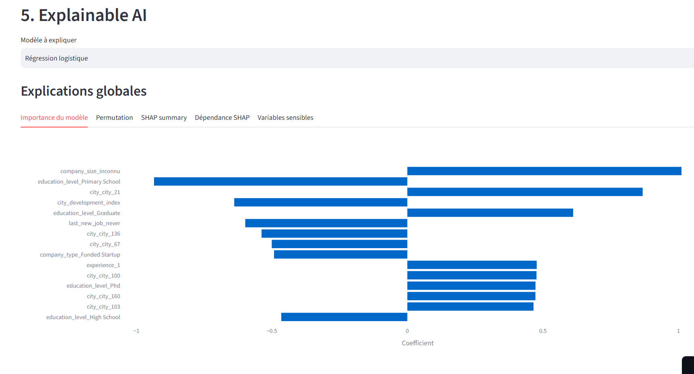
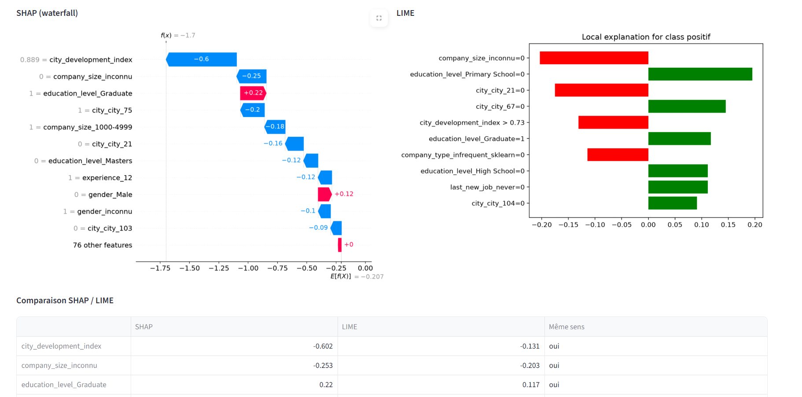
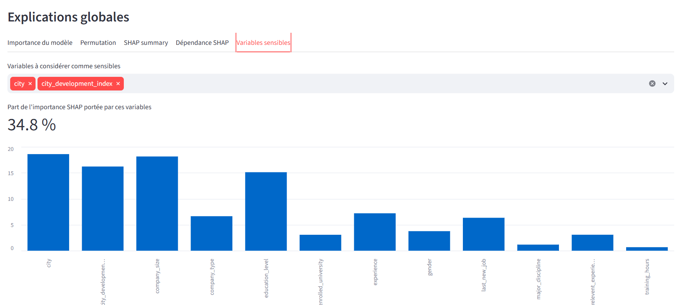

# Mobilité des candidats Data Scientists : classification explicable

Projet **Challenge 1** du cours Data Mining (ENSI, filière II3, 2026-2027), encadré par Rym Besrour.
Cas n°9 du catalogue : **HR Analytics, Job Change of Data Scientists** (Kaggle).

Application web interactive qui charge les données, entraîne et compare cinq modèles de classification, puis explique leurs décisions (globalement et candidat par candidat) avec SHAP et LIME, dans un langage compréhensible par un décideur RH.

## Liens

| Livrable | Lien |
|---|---|
| Application déployée (Streamlit Community Cloud) | https://mobilite-candidats-classification-explicable-zttjebzfinjxgevrw.streamlit.app/ |
| API d'interprétation (FastAPI, documentation interactive) | https://mobilite-candidats-classification.onrender.com/docs |
| Dépôt GitHub | https://github.com/zeineb710/mobilite-candidats-classification-explicable |
| Jeu de données (Kaggle) | https://www.kaggle.com/datasets/arashnic/hr-analytics-job-change-of-data-scientists |

## Problème métier

Un service RH ou un cabinet de recrutement veut anticiper quels candidats data scientists vont chercher un nouvel emploi, afin de cibler ses actions de recrutement et de fidélisation. Le score influence des décisions concernant des personnes : le modèle doit être performant, mais aussi explicable.

**Données** : 19 158 candidats, 14 variables. La cible indique si le candidat cherche un nouvel emploi (**24,9 % de classe positive**, jeu déséquilibré).

## Fonctionnalités

L'application couvre les six modules demandés.

1. **Données** : téléchargement automatique du jeu (ou import d'un CSV), aperçu, statistiques descriptives, valeurs manquantes, proportion de chaque classe, visualisations interactives.
2. **Préparation** : choix de la cible et des variables, traitement des valeurs manquantes, encodage des catégories, normalisation, séparation entraînement / test paramétrable.
3. **Modélisation** : régression logistique, arbre de décision, k plus proches voisins, Random Forest et XGBoost, avec optimisation des hyperparamètres et tableau comparatif automatique.
4. **Évaluation** : AUC-ROC, PR-AUC, précision, rappel et F1 sur la classe d'intérêt, courbes ROC et précision-rappel superposées, matrice de confusion, curseur de seuil de décision.
5. **Explainable AI** : importance propre au modèle, importance par permutation, SHAP summary et dépendance, explication d'un candidat (SHAP waterfall et LIME, comparaison des deux, phrase de synthèse), analyse des variables sensibles.
6. **API (FastAPI)** : service documenté, appelé par l'application.

## Résultats principaux

Jeu de test (3 832 candidats), seuil de décision 0,5. Tableau trié par AUC-ROC décroissant.

| Modèle | AUC-ROC | PR-AUC | Précision | Rappel | F1 |
|---|---|---|---|---|---|
| XGBoost | **0,819** | **0,559** | 0,544 | 0,770 | 0,637 |
| Random Forest | 0,810 | 0,545 | 0,542 | 0,786 | **0,642** |
| Arbre de décision | 0,810 | 0,534 | 0,510 | 0,792 | 0,620 |
| Régression logistique | 0,809 | 0,557 | 0,531 | 0,784 | 0,633 |
| k plus proches voisins | 0,799 | 0,529 | 0,575 | 0,524 | 0,548 |

- XGBoost a le meilleur AUC-ROC, mais l'écart avec la régression logistique est négligeable (0,010 d'AUC-ROC, 0,002 de PR-AUC). XGBoost est aussi bien plus lent à entraîner (82 s contre 5,6 s).
- **Modèle recommandé : la régression logistique**, car sa performance est quasi identique et ses coefficients se lisent directement.

### Explications

- Les variables les plus influentes sont `company_size_inconnu`, `city_development_index` et `education_level_Graduate`. Les modalités « inconnu » figurent parmi les plus importantes : le modèle exploite en partie l'absence d'information, qui reflète la collecte des données plutôt qu'un comportement réel.
- SHAP et LIME s'accordent sur le sens des effets, mais pour chaque modèle seules 2 des 5 variables principales sont communes aux deux méthodes.

### Équité

| Modèle | Part de l'importance SHAP : localisation (`city` + `city_development_index`) |
|---|---|
| Régression logistique | 34,8 % |
| XGBoost | [XX,X] % |
| Random Forest | 38,1 % |

Le genre porte une part très faible de l'importance SHAP (1,6 % pour XGBoost), alors que la localisation en porte environ 35 à 38 %. Le modèle ne s'appuie donc pas directement sur le genre, mais dépend fortement de l'origine géographique, ce qui constitue un risque de discrimination indirecte. Le score doit servir à prioriser des échanges avec les candidats, jamais à les exclure.

## Captures d'écran

### 1. Données


### 2. Préparation


### 3. Modélisation et comparaison


### 4. Évaluation


### 5. Explainable AI : explications globales


### 5. Explainable AI : explication d'un candidat (SHAP / LIME)


### 5. Explainable AI : variables sensibles


### 6. API FastAPI (documentation)


## Structure du dépôt

```
.
├── app.py                # application Streamlit
├── api.py                # API FastAPI
├── prep.py               # préparation des données
├── models.py             # entraînement et optimisation des modèles
├── evaluation.py         # métriques et tableau comparatif
├── explain.py            # SHAP, LIME, importance par permutation
├── artifacts/            # [préciser : modèles entraînés / objets sauvegardés]
├── notebook.ipynb        # notebook d'analyse
├── requirements.txt
├── README.md
└── docs/captures/        # captures d'écran
```

## Installation et lancement en local

```bash
git clone https://github.com/zeineb710/mobilite-candidats-classification-explicable.git
cd mobilite-candidats-classification-explicable
pip install -r requirements.txt
```

Lancer l'API, puis l'application, dans deux terminaux :

```bash
uvicorn api:app --reload
streamlit run app.py
```

L'API est alors disponible sur `http://127.0.0.1:8000`, avec sa documentation interactive sur `http://127.0.0.1:8000/docs`.


## Notebook

`notebook.ipynb` est un notebook autonome qui déroule toute l'analyse (données, préparation, modélisation, évaluation, explications, équité). Il s'ouvre avec Jupyter, VS Code, Colab ou GitHub Codespaces.

## Déploiement

- **Application** : Streamlit Community Cloud.
- **API** : Render. Si l'API est en veille, le premier appel peut être plus lent.

## Limites

- Données déclaratives et déséquilibrées, avec beaucoup de valeurs manquantes.
- La compensation du déséquilibre des classes rend les probabilités non calibrées.
- SHAP et LIME décrivent ce que le modèle utilise, pas ce qui cause un changement d'emploi.
- Jeu de données Kaggle, sans validation externe.

